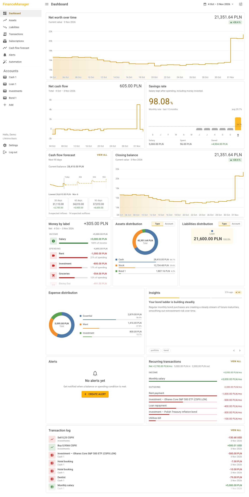
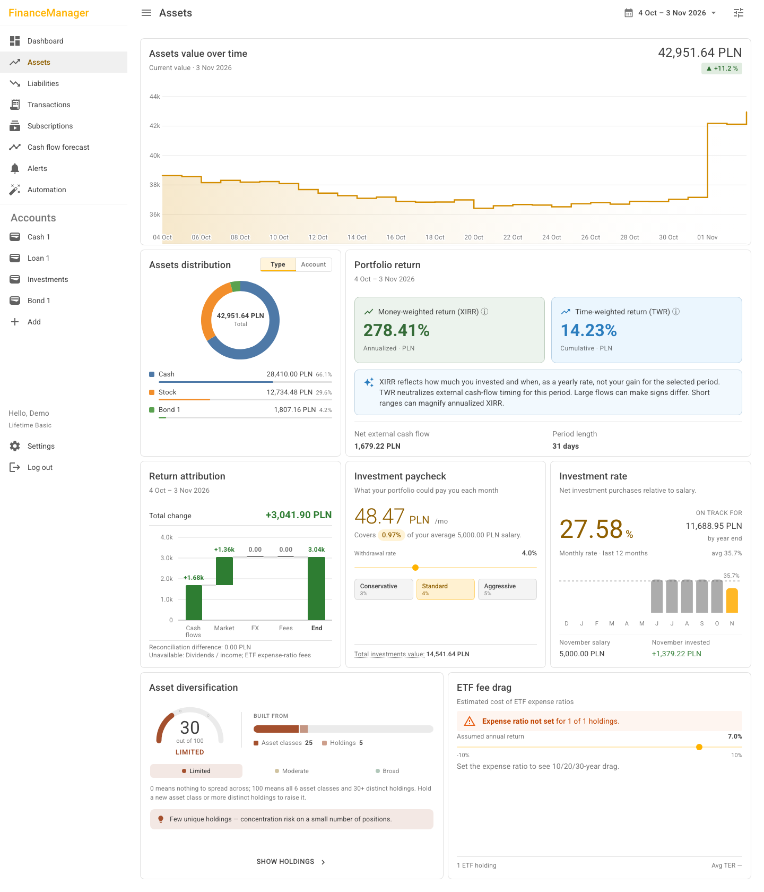
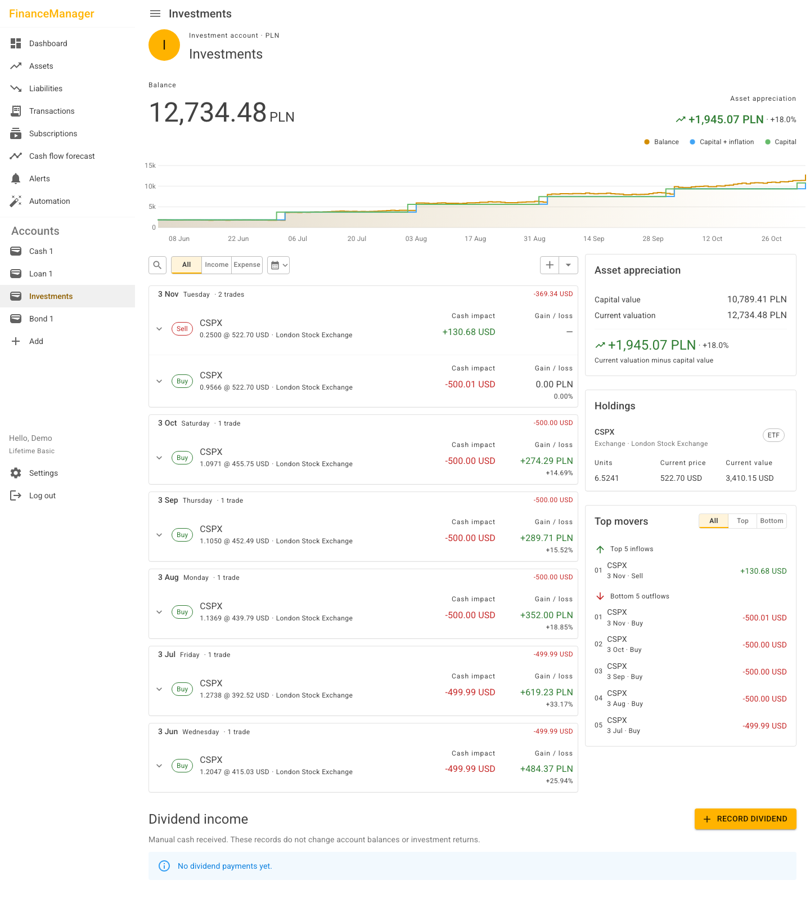
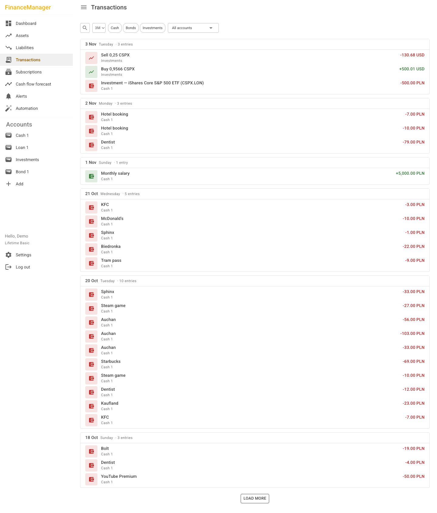
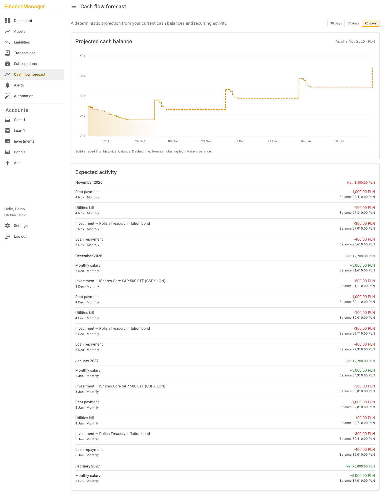

<p align="center">
  <a href="https://github.com/avresial/FinanceManager/stargazers"></a>
  <a href="https://github.com/avresial/FinanceManager/issues"></a>
  
  
  <a href="https://financemanager.mikikarkowski.dev/login"></a>
</p>

# FinanceManager

**FinanceManager** is an open-source personal finance tracker built with Blazor WebAssembly and ASP.NET Core. It brings cash, loans, stocks, ETFs and bonds together in one place, with dashboards, portfolio analytics, cash flow forecasting, AI-generated insights and live market data.

> **[Live App](https://financemanager.mikikarkowski.dev/login)** — use **Check out demo** to explore a pre-filled guest account without signing up.

---

## Screenshots

### Dashboard
Net worth, cash flow, savings rate, cash flow forecast, distributions, AI insights, alerts, recurring transactions and recent activity on one customizable page.



### Assets
Portfolio analytics for everything you own: value over time, distribution, money- and time-weighted returns, return attribution, investment paycheck, diversification and ETF fee drag.



### Account details
Each account has its own balance chart, entry history and side cards. Investment accounts show trades, capital vs. value, holdings, top movers and dividend income.



### Transactions
Every entry across all accounts, grouped by day, with text search, date range and account filters.



### Cash flow forecast
A deterministic 30, 60 or 90-day projection of your cash balance from recurring income, expenses and subscriptions.



---

## Features

### Dashboard
A customizable grid of cards for the selected date range:

- **Net worth, closing balance and net cash flow** — time series charts with change against the start of the range
- **Savings rate** — monthly salary, spending and savings with a salary-weighted yearly average
- **Cash flow forecast** — upcoming balance with 30/60/90-day totals
- **Money by label and expense distribution** — where income comes from and where spending goes
- **Assets and liabilities distribution** — by type or by account
- **Insights (AI)** — a carousel of generated observations about your finances
- **Alerts, recurring transactions and transaction log** — what needs attention and what happened recently

Every card has an info tooltip that explains what it shows.

### Accounts
| Account type | What it tracks |
|---|---|
| **Cash** | Bank balances, everyday transactions and loans |
| **Investment** | Stocks and ETFs, with buy/sell trades, live prices, holdings and manually recorded dividends |
| **Bond** | Fixed-income securities, including inflation-linked bonds |

Accounts can be added, renamed or deleted, and transactions keep their original currency.

### Assets and liabilities
- **Portfolio return** — annualized money-weighted return (XIRR) and cumulative time-weighted return (TWR)
- **Return attribution** — total change split into cash flows, market, FX and fees
- **Investment paycheck and investment rate** — what the portfolio could pay you monthly and how much of your salary you invest
- **Asset diversification** — a 0–100 score across asset classes and holdings
- **ETF fee drag** — annual expense-ratio cost projected over 10, 20 and 30 years
- **Liabilities** — debt over time and by account

### Money management
- **Transactions** — all entries across accounts with search and filters
- **Subscriptions** — detected recurring charges with monthly and annual cost; flag them for review, mute them or mark them as cancelled
- **Cash flow forecast** — projected balance and expected activity by month
- **Alerts and watchlists** — notify on balances, category or merchant spending, large transactions and subscription price changes
- **Automation** — ordered rules that label and normalize new, imported or existing transactions, with a before/after test

### Data management
- **CSV import and export** — map custom CSV headers and resolve import conflicts
- **Shared instrument catalogue** — search existing and external instruments when adding a trade, and add new ones to the catalogue

### Market data
- Stock and ETF prices from **Alpha Vantage** and **Twelve Data**, with instrument metadata from **EODHD** and **OpenFIGI**
- Currency exchange rates from **NBP**, the **ECB** and Alpha Vantage
- Prices are cached in the database to keep external API calls low

### AI
- **Insights** — model-generated observations based on your accounts and transactions
- **Automatic labelling** — suggests labels for cash account transactions
- **MCP integration** — connect ChatGPT, Claude and other MCP clients through OAuth, without copying an API key or password
- Configurable providers and fallback order: **OpenRouter**, **GitHub Models**, **Ollama** and **LM Studio**

### Users and administration
- JWT authentication with registration, login and password recovery, plus a guest demo account
- Settings for profile, preferred currency, investment benchmark, password and plan; gift codes unlock plan upgrades
- Admin panel for users, labels, instruments, bonds, prices, AI providers, service keys, gift codes and application logs

---

## Tech Stack

| Layer | Technology |
|---|---|
| Frontend | Blazor WebAssembly, MudBlazor, ApexCharts (Blazor-ApexCharts) |
| Backend | ASP.NET Core 10, SignalR, Entity Framework Core, OpenIddict (MCP OAuth) |
| Database | PostgreSQL (SQL Server also supported) |
| AI / LLM | OpenRouter, GitHub Models, Ollama, LM Studio; Model Context Protocol server |
| Market data | Alpha Vantage, Twelve Data, EODHD, OpenFIGI, NBP, ECB |
| Observability | OpenTelemetry (OTLP export) |
| Local orchestration | .NET Aspire |
| Testing | xUnit v3, Moq, bUnit, WebApplicationFactory, ArchUnitNET |

The solution follows a **layered modular monolith** architecture. Read the [arc42 architecture documentation](docs/architecture/README.md) for system context, project boundaries, runtime flows, deployment, decisions, quality requirements, risks and terminology. Detailed operational guides and historical audits are indexed there.

---

## Getting Started

### Prerequisites
- [.NET 10 SDK](https://dotnet.microsoft.com/download)
- PostgreSQL **or** SQL Server
- (Optional) Docker, for running PostgreSQL through .NET Aspire

### Run with Aspire (recommended)
```bash
dotnet run --project code/AppHost
```
This starts a PostgreSQL container and the API automatically (requires Docker).

### Run manually
```bash
# Restore and build
dotnet restore ./code
dotnet build ./code/FinanceManager.slnx

# Apply database migrations
dotnet ef database update -s code/FinanceManager.Api/FinanceManager.Api.csproj

# Start the API (also serves the Blazor WASM client)
dotnet run --project code/FinanceManager.Api
```

Then open the application URL printed by `dotnet run` (the HTTPS launch profile uses `https://localhost:5001`).

For production backup, restore, and rollback steps on Supabase, see [database recovery runbook](docs/architecture/operations/database-recovery.md).

### Run tests
Run from inside the `code/` directory so the test runner can locate `global.json`, and use `--project` as required by the Microsoft Testing Platform.
```bash
cd code

# All tests
dotnet test --project ./FinanceManager.slnx

# Unit tests only
dotnet test --project ./FinanceManager.Tests.Unit/FinanceManager.Tests.Unit.csproj

# Integration tests (uses an in-memory database in the test host)
UseInMemoryDatabase=true dotnet test --project ./FinanceManager.Tests.Integration/FinanceManager.Tests.Integration.csproj
```

### External API keys (optional)
Supply these via environment variables or .NET User Secrets — never commit them. Admins can also set them at runtime under **Admin → Service keys** and **Admin → AI providers**.

| Variable | Service |
|---|---|
| `StockApi__ApiKey` | Alpha Vantage stock prices and exchange rates |
| `TwelveData__ApiKey` | Twelve Data stock prices |
| `Eodhd__ApiKey` | EODHD instrument data |
| `OpenFigi__ApiKey` | OpenFIGI instrument identifiers |
| `OpenRouter__ApiKey` | OpenRouter LLM |
| `GitHubModels__ApiKey` | GitHub Models LLM |

---

## Author

- **[avresial](https://github.com/avresial)**
