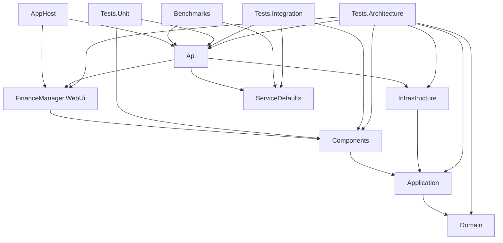

# 5. Building block view

[Architecture index](README.md)

## 5.1 Level 1: system and repository map

The deployable system consists of the API host and the browser assets it publishes. The host composes Application and Infrastructure; the browser composes Components and shared Application/Domain types. AppHost orchestrates local infrastructure rather than becoming a production business service.

| Block / path | Owns | Boundary and evidence |
|---|---|---|
| [FinanceManager](../../code/FinanceManager) / `FinanceManager.WebUi.csproj` | WASM root components, browser bootstrap, API-base client, browser storage/authorization registrations | [Program.cs](../../code/FinanceManager/Program.cs); no controller or persistence implementation |
| [FinanceManager.Components](../../code/FinanceManager.Components) | Feature pages/components, typed HTTP clients, browser services, caches/snapshots and interactive state | [ServiceCollectionExtension](../../code/FinanceManager.Components/ServiceCollectionExtension.cs); no API/Infrastructure project reference |
| [FinanceManager.Api](../../code/FinanceManager.Api) | HTTP controllers, middleware, bearer/OAuth setup, SignalR, hosted workers, EF migrations, static client hosting | [Program.cs](../../code/FinanceManager.Api/Program.cs); route/host and worker coordination rather than reusable financial calculations |
| [FinanceManager.Application](../../code/FinanceManager.Application) | Use-case services, valuation/performance, providers and fallback coordination, import/insight/label orchestration, seeders, shared browser services | [registrations](../../code/FinanceManager.Application/ServiceCollectionExtension.cs); no Infrastructure project dependency or direct EF context |
| [FinanceManager.Domain](../../code/FinanceManager.Domain) | Entities, repository and service contracts, DTOs, value/result types, commands and domain concepts | [project](../../code/FinanceManager.Domain/FinanceManager.Domain.csproj); no other project reference or ASP.NET/EF package reference |
| [FinanceManager.Infrastructure](../../code/FinanceManager.Infrastructure) | EF context/model/configurations, repositories and cache decorators, external market/FX/AI adapters, OAuth persistence support | [AppDbContext](../../code/FinanceManager.Infrastructure/Persistence/AppDbContext.cs), [registrations](../../code/FinanceManager.Infrastructure/ServiceCollectionExtension.cs); no page or controller definitions |
| [AppHost](../../code/AppHost) | Aspire PostgreSQL 17 resource, persistent local volume, pgAdmin, API startup/reference/wait | [AppHost.cs](../../code/AppHost/AppHost.cs); local orchestration, no feature logic |
| [ServiceDefaults](../../code/ServiceDefaults) | OpenTelemetry, HTTP resilience/discovery defaults, health endpoints | [Extensions.cs](../../code/ServiceDefaults/Extensions.cs); shared host concerns |
| [FinanceManager.Tests.Unit](../../code/FinanceManager.Tests.Unit) | Direct controller/service/domain tests, mocks, bUnit components | [project](../../code/FinanceManager.Tests.Unit/FinanceManager.Tests.Unit.csproj); grouped by layers/features |
| [FinanceManager.Tests.Integration](../../code/FinanceManager.Tests.Integration) | Test hosts, route/auth behavior, repository/provider-specific fixtures | [FinanceManagerApiTestApp](../../code/FinanceManager.Tests.Integration/FinanceManagerApiTestApp.cs); InMemory default is not production-provider equivalence |
| [FinanceManager.Tests.Architecture](../../code/FinanceManager.Tests.Architecture) | Compiled dependency rules and controller test-file coverage convention | [LayerDependencyTests](../../code/FinanceManager.Tests.Architecture/LayerDependencyTests.cs), [ControllerCoverageTests](../../code/FinanceManager.Tests.Architecture/ControllerCoverageTests.cs) |
| [FinanceManager.Benchmarks](../../code/FinanceManager.Benchmarks) | Isolated performance measurements | [project](../../code/FinanceManager.Benchmarks/FinanceManager.Benchmarks.csproj); [benchmark guide](quality/benchmarks.md) |

Additional repository areas:

| Path | Purpose |
|---|---|
| [code/FinanceManager.slnx](../../code/FinanceManager.slnx) | Source solution and project list; `code/` is the implementation source of truth |
| [.github](../../.github) | CI/CD, labels, issue/PR templates, and Copilot instructions |
| [.claude/skills](../../.claude/skills) | Repository agent workflows, including app usage, UI testing, and changelog instructions |
| [resources](../../resources) | Checked-in non-code data, currently including currency-rate CSV input |
| [scripts](../../scripts) | Repository utilities such as bank CSV encoding repair and the changelog fragment compiler |
| [changelog](../../changelog/README.md) | Pending changelog fragments, compiled into `CHANGELOG.md` on request (CI only validates them) |
| [ReadmeElements/Imgs](../../ReadmeElements/Imgs) | README visual assets |
| [docs/architecture](README.md) | Architecture, detailed concepts, operations, quality evidence, and dated audits |
| [README.md](../../README.md), [CHANGELOG.md](../../CHANGELOG.md), [CLAUDE.md](../../CLAUDE.md), [AGENTS.md](../../AGENTS.md) | Product entry point, release history, and governing contributor/agent instructions |

The earlier structure document listed `sample-data/` and root `_framework/`, `_content/`, `index.html`, and compressed published assets. Those paths are absent in this checkout. Publishing generates browser assets for the API; generated output is not an editable source block.

## 5.2 Project-reference view

Arrows below mean **direct `ProjectReference`**, not runtime calls or ideal dependency direction. The diagram is derived from the current `.csproj` files. Transitive references are intentionally not drawn.

Reference evidence: [API](../../code/FinanceManager.Api/FinanceManager.Api.csproj), [WebUi](../../code/FinanceManager/FinanceManager.WebUi.csproj), [Components](../../code/FinanceManager.Components/FinanceManager.Components.csproj), [Infrastructure](../../code/FinanceManager.Infrastructure/FinanceManager.Infrastructure.csproj), [Application](../../code/FinanceManager.Application/FinanceManager.Application.csproj), [Domain](../../code/FinanceManager.Domain/FinanceManager.Domain.csproj), [AppHost](../../code/AppHost/AppHost.csproj), [ServiceDefaults](../../code/ServiceDefaults/ServiceDefaults.csproj), and the verification projects in the table above.

Domain and ServiceDefaults have no project references. Application references Domain directly, while Infrastructure and Components reference Application directly. API obtains Application/Domain transitively and references WebUi to host its built client. AppHost's WebUi reference exists even though [AppHost.cs](../../code/AppHost/AppHost.cs) currently creates only API and PostgreSQL resources. The architecture tests analyze type dependencies; a packaging reference is not the same as a server type depending on a UI type.

## 5.3 Level 2: feature slices and shared services

Feature organization is similar across projects but not identical: Domain/Application primarily use named feature folders; API/Infrastructure/Components use `Features/`. Shared infrastructure concerns use `Shared/`, `Persistence/`, and bootstrap registrations. Folder names are navigation aids, not independently isolated bounded contexts.

| Feature/refinement | Principal model and implementation responsibilities | Evidence |
|---|---|---|
| Identity | Users, roles, gift codes, lockout, rotating refresh sessions, development login, guest sandbox lifecycle | [Domain Identity](../../code/FinanceManager.Domain/Identity), [Application Identity](../../code/FinanceManager.Application/Identity), [API Identity](../../code/FinanceManager.Api/Features/Identity) |
| Currency accounts and imports | Accounts/entries, CSV mapping, conflicts, import persistence, async job status/progress | [currency contracts](../../code/FinanceManager.Domain/FinancialAccounts/Currencies), [import service](../../code/FinanceManager.Application/FinancialAccounts/Currencies/Import/CurrencyAccountImportService.cs), [import API](../../code/FinanceManager.Api/Features/FinancialAccounts/Currencies) |
| Assets and investment accounts | Asset identity, exchange listing, provider symbol, normalized quote; transactions determine holdings, valuations price listings | [asset model](../../code/FinanceManager.Domain/Assets/Entities), [InvestmentValuationService](../../code/FinanceManager.Application/FinancialAccounts/Investments/Valuation/InvestmentValuationService.cs), [asset repositories](../../code/FinanceManager.Infrastructure/Features/Assets/Repositories) |
| Bonds | Bond details, currency, unit value, account entries, import, and bond-specific calculations | [Domain Bonds](../../code/FinanceManager.Domain/FinancialAccounts/Bond), [Application Bonds](../../code/FinanceManager.Application/FinancialAccounts/Bond) |
| Portfolio performance and money flow | Native movement ledger, opening/closing valuation, money-weighted return, attribution, financial flow and recurring-payment analysis | [performance services](../../code/FinanceManager.Application/FinancialAccounts/Investments/Performance), [MoneyFlow](../../code/FinanceManager.Application/MoneyFlow) |
| Dashboard | Cross-account query orchestration, financial cards and charts, per-user invalidation, rendered snapshots, and a cursor-paged transaction log | [Application Dashboard](../../code/FinanceManager.Application/Dashboard), [Domain dashboard contracts](../../code/FinanceManager.Domain/Dashboard), [Components Dashboard](../../code/FinanceManager.Components/Features/Dashboard) |
| Labels, rules, insights, alerts | Automatic/generated classification, transaction automation, insights generation, alert evaluation | [labels](../../code/FinanceManager.Application/Labels), [rules](../../code/FinanceManager.Application/TransactionRules), [insights](../../code/FinanceManager.Application/Insights), [alerts](../../code/FinanceManager.Application/Alerts) |
| Administration and maintenance | Users, provider/key configuration, logs, retention, health, price backfill, maintenance actions | [API Administration](../../code/FinanceManager.Api/Features/Administration), [API Maintenance](../../code/FinanceManager.Api/Features/Maintenance), [Application Administration](../../code/FinanceManager.Application/Administration) |
| MCP | Discovery, OAuth bridge/authorization, user-scoped tool groups, client grant revocation | [API MCP](../../code/FinanceManager.Api/Features/Mcp), [OAuth infrastructure](../../code/FinanceManager.Infrastructure/Features/Mcp/OAuth) |

## 5.4 Level 3: selected internal boundaries

### Asset identity, quote, and valuation

`Asset` identifies the instrument; `AssetListing` describes a tradable listing with optional `ExchangeMic`/`TradingCurrency` (when curated or discovered completely) and price multiplier; `MarketDataSymbol` maps that listing to a provider-specific symbol. [AssetListingConfiguration](../../code/FinanceManager.Infrastructure/Persistence/Configurations/AssetListingConfiguration.cs) enforces uniqueness on `(Ticker, ExchangeMic, TradingCurrency)` via a filtered index (`ExchangeMic IS NOT NULL AND TradingCurrency IS NOT NULL`) so PostgreSQL and SQL Server treat incomplete listings identically while application import deduplicates incomplete entries by FIGI, ISIN, or ticker/venue. `PriceQuote` stores normalized price/currency together with raw quote metadata and provenance. [InvestmentPriceProvider](../../code/FinanceManager.Application/Assets/Pricing/InvestmentPriceProvider.cs) normalizes and stores provider prices, resolves FX, and caches suitable results, returning `null` for listings whose `TradingCurrency` has not yet been curated. [InvestmentTransactionValuationService](../../code/FinanceManager.Application/FinancialAccounts/Investments/Valuation/InvestmentTransactionValuationService.cs) converts historical purchase values using the recorded `InvestmentTransaction.Currency`; later listing enrichment does not reinterpret stored transaction amounts. Current market prices retain their quote/listing currency. Holdings are derived from [investment transactions](../../code/FinanceManager.Domain/FinancialAccounts/Investments/Entities/InvestmentTransaction.cs), not stored quote rows.

[PortfolioPeriodLedger](../../code/FinanceManager.Application/FinancialAccounts/Investments/Performance/PortfolioPeriodLedger.cs) shares normalized movements between return calculations while preserving quantity changes separately. This avoids making the ledger responsible for valuation, FX, or return signs. See [solution strategy](04-solution-strategy.md#43-financial-calculation-separation) for interpretation boundaries.

### Persistence and cache decoration

[AppDbContext](../../code/FinanceManager.Infrastructure/Persistence/AppDbContext.cs) owns the shared model and applies configurations. Repository contracts live with domain features; Infrastructure supplies adapters. Currency/bond entry repositories are wrapped by cached decorators registered in [AddCachedEntryRepositories](../../code/FinanceManager.Infrastructure/ServiceCollectionExtension.cs). Owner resolution and invalidation are explicit collaborators; cached reads cannot be treated as an independent source of truth.

[Currency/bond entry contracts](../../code/FinanceManager.Domain/FinancialAccounts/Shared/Repositories/IAccountEntryRepository.cs) and [investment transaction contracts](../../code/FinanceManager.Domain/FinancialAccounts/Investments/Repositories/IInvestmentTransactionRepository.cs) expose bounded multi-account history queries for composing transaction logs. The repositories filter the inclusive date range and exclusive date/id cursor before ordering and limiting rows in EF; callers supply the account scope and requested count. Currency/bond use `(AccountId, PostingDate, EntryId)` indexes, and investments use `(AccountId, TradeDate, Id)`. [Repository integration tests](../../code/FinanceManager.Tests.Integration/Repositories/MultiAccountHistoryPageTests.cs) cover paging on InMemory and SQLite; these checks do not establish deployed PostgreSQL/SQL Server performance.

The Dashboard domain defines [TransactionLogQuery](../../code/FinanceManager.Domain/Dashboard/Dtos/TransactionLogQuery.cs) with start/end dates, a page size (default 25), an optional [TransactionLogCursor](../../code/FinanceManager.Domain/Dashboard/Dtos/TransactionLogCursor.cs) (`Date`, `AccountType`, `EntryId`), and optional `AccountTypes` and `AccountIds` filters (null or empty means no filter; the two are AND-combined), plus [TransactionLogPage](../../code/FinanceManager.Domain/Dashboard/Dtos/TransactionLogPage.cs) (`Items`, `NextCursor`). [TransactionLogService](../../code/FinanceManager.Application/Dashboard/TransactionLogService.cs) buffers owner-account streams before running bounded history queries sequentially, requesting `pageSize + 1` rows for each account type. A stream whose account type is not selected is skipped entirely (no account query, no entry query); `AccountIds` is intersected with the owner's own accounts of each stream before any entry query, and a stream whose intersection is empty is skipped. Account IDs that do not belong to the user are therefore silently ignored and never reach a repository. Filters do not change the ordering or cursor semantics, so paging stays gap-free under them. It merges and orders results by date descending, entry ID descending, then account type in the fixed Currency → Bond → Stock order for exact ties; the lookahead row determines whether a next cursor is returned. The [paged endpoint](../../code/FinanceManager.Api/Features/Dashboard/Controllers/TransactionLogController.cs) at `GET api/TransactionLog/Page/{userId}` validates page size (1–100), start ≤ end, cursor fields as all present or all absent, supported account type, and positive entry ID, and accepts the filters as repeated `accountTypes` (defined `AccountType` names) and `accountIds` (positive integers, at most 100) query parameters, answering `400` otherwise; it denies access when the authenticated user does not match the requested user. Range and cursor timestamps without an offset are interpreted as UTC, and investment trade dates map to UTC midnight. The typed [TransactionLogHttpClient](../../code/FinanceManager.Components/Features/MoneyFlow/HttpClients/TransactionLogHttpClient.cs) exposes `GetPage`, repeating `accountTypes` / `accountIds` for each filter value. The existing `GET api/TransactionLog/Get/{userId}` endpoint and its behavior remain unchanged. The [Transactions page](../../code/FinanceManager.Components/Features/Dashboard/Components/Pages/TransactionsPage.razor) (`/Transactions`, linked from the navigation menu and the dashboard Transaction log card) is the browser consumer of `GetPage`: it loads the selected date range one page at a time ("Load more" with `NextCursor`), restarts from the first page whenever the range or an account filter changes (the toolbar offers Cash / Bonds / Investments type chips and an account multi-select narrowed to the selected types; the account list comes from `IFinancialAccountService` once on page init), and discards responses of superseded loads through a [RefreshVersionGate](../../code/FinanceManager.Components/Shared/Services/RefreshVersionGate.cs). It renders the rows through the same [TransactionLogRow](../../code/FinanceManager.Components/Features/Dashboard/Components/TransactionLogRow.razor) as the card; each row links to `/AccountDetails/{accountId}`, with `?entryId=` for currency entries. The page paints no snapshot; it always loads live.

### Browser state and snapshots

[ISnapshotService](../../code/FinanceManager.Components/Shared/Services/ISnapshotService.cs) stores a surface's last-rendered model. [SnapshotRefreshCoordinator](../../code/FinanceManager.Components/Shared/Services/SnapshotRefreshCoordinator.cs) paints it, invokes a fresh load, compares content, and persists changed rendered state. The caller owns [RefreshVersionGate](../../code/FinanceManager.Components/Shared/Services/RefreshVersionGate.cs) and context matching. [LocalStorageStateCacheService](../../code/FinanceManager.Components/Shared/Services/LocalStorageStateCacheService.cs) is a different TTL cache that may skip a fetch. See [UI snapshots](concepts/ui-snapshots.md).

### Background jobs

The host registers channels and services for insights, labels, currency import, price backfill, guest cleanup, and database logs/retention in [ApiConfigurationExtensions](../../code/FinanceManager.Api/ApiConfigurationExtensions.cs). Singleton channels/stores admit and track work; workers create scopes to resolve repositories and services. This allows request handlers to return before execution, but it does not create durable distributed queues. The [runtime view](06-runtime-view.md) details currency import admission, execution, notification, and conflict resolution.

## Provider symbol resolution during instrument import

[InstrumentImportService](../../code/FinanceManager.Application/FinancialAccounts/Investments/Discovery/InstrumentImportService.cs) delegates market-data mapping to [MarketDataSymbolResolutionService](../../code/FinanceManager.Application/FinancialAccounts/Investments/Discovery/MarketDataSymbolResolutionService.cs). Its Application [resolver port](../../code/FinanceManager.Application/FinancialAccounts/Investments/Discovery/IMarketDataSymbolResolver.cs) has Alpha Vantage, Twelve Data and EODHD Infrastructure adapters. Each searches the listing identity, correlates ticker/venue/currency and validates a candidate against that provider's recent prices. The orchestrator returns a separate result for each configured adapter; failures do not short-circuit the remaining providers.

Administrator import persists both resolved and failed diagnostic mappings, while user-initiated transaction import saves confirmed external instruments directly to the shared catalog even when venue (`ExchangeMic`), `TradingCurrency`, `AssetType`, or provider symbols are missing. Transaction import carries a [validated import](../../code/FinanceManager.Domain/Assets/Discovery/ValidatedInstrumentImport.cs) into the atomic database operation so no provider HTTP runs inside it: resolved provider mappings are persisted and enabled, whereas unresolved or unavailable providers leave no symbol rows so listings without enabled symbols surface for later administrative completion. Only unrecognized instruments (no catalog or external match, or blank ticker and name) are refused. Existing administrator-maintained asset and mapping values are preserved.

### Admin catalog discovery

The [admin asset editor](../../code/FinanceManager.Components/Features/Administration/Components/AdminEditAsset.razor) integrates external search, field review, listing discovery and provider-symbol candidates. [AdminAssetDiscoveryService](../../code/FinanceManager.Application/FinancialAccounts/Investments/Discovery/AdminAssetDiscoveryService.cs) composes the existing discovery and symbol-resolution services behind [Admin-only endpoints](../../code/FinanceManager.Api/Features/Assets/Controllers/AdminAssetDiscoveryController.cs). ISIN or share-class FIGI lookup expands a selected instrument to its known venues. Only selected listing drafts trigger symbol resolution. The standalone list-page import overlay has been retired.

External data stays in a browser draft until confirmation. Existing asset fields require individual acceptance followed by Save; adding a missing listing or symbol never upserts existing catalog metadata or re-enables an existing disabled mapping. New assets and their selected listing/symbol graph are validated before one repository insert/SaveChanges; no provider HTTP runs during persistence. A listing's trading currency does not establish the asset's base currency, and metadata unavailable through the current discovery contracts remains empty. [Service tests](../../code/FinanceManager.Tests.Unit/Application/Services/Discovery/AdminAssetDiscoveryServiceTests.cs), [UI state tests](../../code/FinanceManager.Tests.Unit/Components/Features/Administration/AdminAssetDiscoveryTests.cs) and [API integration tests](../../code/FinanceManager.Tests.Integration/Features/Assets/Controllers/AdminAssetDiscoveryControllerTests.cs) cover these boundaries.

### Incomplete instrument administration

The Assets administration page includes an Incomplete tab. [IncompleteAssetQueueService](../../code/FinanceManager.Application/FinancialAccounts/Investments/Discovery/IncompleteAssetQueueService.cs) coordinates a bounded, server-paged [repository query](../../code/FinanceManager.Infrastructure/Features/Assets/Repositories/AssetRepository.cs) and recent-price validation before saving a symbol. The [admin-only controller](../../code/FinanceManager.Api/Features/Assets/Controllers/IncompleteAssetsController.cs) exposes the queue and symbol repair operations to the typed browser client. Missing identity/type/venue/currency, missing enabled symbols, all enabled symbols failing, and no successful fetch within seven days keep a row in the queue; assets without listings are included. Holder counts use positive net investment transaction quantities per user. Metadata suggestions are reviewed before using the existing asset/listing update endpoints; each update is persisted separately and a partial failure is reported. Successful symbol validation records the price-fetch timestamp and clears its prior error. Optional automatic price backfill is not triggered by this workflow.
