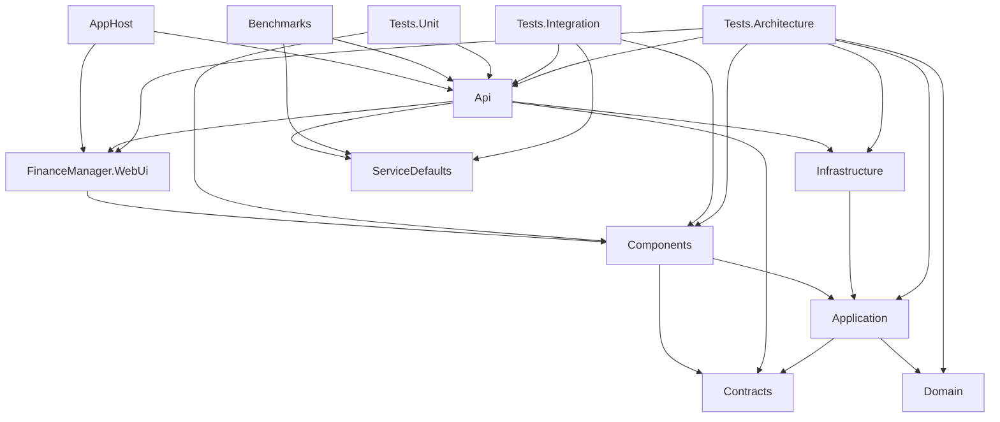

# 5. Building block view

[Architecture index](README.md)

## 5.1 Level 1: system and repository map

The deployable system consists of the API host and the browser assets it publishes. The host composes Application and Infrastructure; the browser composes Components and shared Application/Domain types. AppHost orchestrates local infrastructure rather than becoming a production business service.

| Block / path | Owns | Boundary and evidence |
|---|---|---|
| [FinanceManager](../../code/FinanceManager) / `FinanceManager.WebUi.csproj` | WASM root components, browser bootstrap, API-base client, browser storage/authorization registrations | [Program.cs](../../code/FinanceManager/Program.cs); no controller or persistence implementation |
| [FinanceManager.Components](../../code/FinanceManager.Components) | Feature pages/components, typed HTTP clients, browser services, caches/snapshots and interactive state | [ServiceCollectionExtension](../../code/FinanceManager.Components/ServiceCollectionExtension.cs); no API/Infrastructure project reference |
| [FinanceManager.Api](../../code/FinanceManager.Api) | HTTP controllers, middleware, bearer/OAuth setup, SignalR, hosted workers, EF migrations, static client hosting | [Program.cs](../../code/FinanceManager.Api/Program.cs); route/host and worker coordination rather than reusable financial calculations |
| [FinanceManager.Application](../../code/FinanceManager.Application) | Use-case services, valuation/performance, providers and fallback coordination, import/insight/label orchestration, seeders, shared browser services | [registrations](../../code/FinanceManager.Application/ServiceCollectionExtension.cs); no Infrastructure project dependency or direct EF context |
| [FinanceManager.Contracts](../../code/FinanceManager.Contracts) | Financial transaction wire DTOs, request records, label payloads and transport enums | Independent project; no Domain, application, persistence or web framework dependencies |
| [FinanceManager.Domain](../../code/FinanceManager.Domain) | Entities, repository and service contracts, value/result types, commands, and remaining legacy DTOs/read models | [project](../../code/FinanceManager.Domain/FinanceManager.Domain.csproj); no other project reference or ASP.NET/EF package reference |
| [FinanceManager.Infrastructure](../../code/FinanceManager.Infrastructure) | EF context/model/configurations, repositories and cache decorators, external market/FX/AI adapters, OAuth persistence support | [AppDbContext](../../code/FinanceManager.Infrastructure/Persistence/AppDbContext.cs), [registrations](../../code/FinanceManager.Infrastructure/ServiceCollectionExtension.cs); no page or controller definitions |
| [AppHost](../../code/AppHost) | Aspire PostgreSQL 17 resource, persistent local volume, pgAdmin, API startup/reference/wait | [AppHost.cs](../../code/AppHost/AppHost.cs); local orchestration, no feature logic |
| [ServiceDefaults](../../code/ServiceDefaults) | OpenTelemetry, HTTP resilience/discovery defaults, health endpoints | [Extensions.cs](../../code/ServiceDefaults/Extensions.cs); shared host concerns |
| [FinanceManager.Tests.Unit](../../code/FinanceManager.Tests.Unit) | Direct controller/service/domain tests, mocks, bUnit components | [project](../../code/FinanceManager.Tests.Unit/FinanceManager.Tests.Unit.csproj); grouped by layers/features |
| [FinanceManager.Tests.Integration](../../code/FinanceManager.Tests.Integration) | Test hosts, route/auth behavior, repository/provider-specific fixtures | [FinanceManagerApiTestApp](../../code/FinanceManager.Tests.Integration/FinanceManagerApiTestApp.cs); InMemory default is not production-provider equivalence |
| [FinanceManager.Tests.Architecture](../../code/FinanceManager.Tests.Architecture) | Compiled dependency rules and controller test-file coverage convention | [LayerDependencyTests](../../code/FinanceManager.Tests.Architecture/LayerDependencyTests.cs), [ControllerCoverageTests](../../code/FinanceManager.Tests.Architecture/ControllerCoverageTests.cs) |
| [FinanceManager.Benchmarks](../../code/FinanceManager.Benchmarks) | Isolated performance measurements | [project](../../code/FinanceManager.Benchmarks/FinanceManager.Benchmarks.csproj); [benchmark guide](quality/benchmarks.md) |

Additional repository areas:

| Path | Purpose |
|---|---|
| [code/FinanceManager.slnx](../../code/FinanceManager.slnx) | Source solution and project list; `code/` is the implementation source of truth |
| [.github](../../.github) | CI/CD, labels, issue/PR templates, and Copilot instructions |
| [.claude/skills](../../.claude/skills) | Repository agent workflows, including app usage, UI testing, and changelog instructions |
| [resources](../../resources) | Checked-in non-code data, currently including currency-rate CSV input |
| [scripts](../../scripts) | Repository utilities such as bank CSV encoding repair and the changelog fragment compiler |
| [changelog](../../changelog/README.md) | Pending changelog fragments, compiled into `CHANGELOG.md` on request (CI only validates them) |
| [ReadmeElements/Imgs](../../ReadmeElements/Imgs) | README visual assets |
| [docs/architecture](README.md) | Architecture, detailed concepts, operations, quality evidence, and dated audits |
| [README.md](../../README.md), [CHANGELOG.md](../../CHANGELOG.md), [CLAUDE.md](../../CLAUDE.md), [AGENTS.md](../../AGENTS.md) | Product entry point, release history, and governing contributor/agent instructions |

The earlier structure document listed `sample-data/` and root `_framework/`, `_content/`, `index.html`, and compressed published assets. Those paths are absent in this checkout. Publishing generates browser assets for the API; generated output is not an editable source block.

## 5.2 Project-reference view

Arrows below mean **direct `ProjectReference`**, not runtime calls or ideal dependency direction. The diagram is derived from the current `.csproj` files. Transitive references are intentionally not drawn.

Reference evidence: [API](../../code/FinanceManager.Api/FinanceManager.Api.csproj), [WebUi](../../code/FinanceManager/FinanceManager.WebUi.csproj), [Components](../../code/FinanceManager.Components/FinanceManager.Components.csproj), [Infrastructure](../../code/FinanceManager.Infrastructure/FinanceManager.Infrastructure.csproj), [Application](../../code/FinanceManager.Application/FinanceManager.Application.csproj), [Domain](../../code/FinanceManager.Domain/FinanceManager.Domain.csproj), [AppHost](../../code/AppHost/AppHost.csproj), [ServiceDefaults](../../code/ServiceDefaults/ServiceDefaults.csproj), and the verification projects in the table above.

Domain, Contracts and ServiceDefaults have no project references. Application references Domain and Contracts directly; Infrastructure references Application directly but its types must not depend on Contracts. Components references Application and Contracts, and API references Contracts directly for its HTTP payloads. API obtains Application/Domain transitively and references WebUi to host its built client. AppHost's WebUi reference exists even though [AppHost.cs](../../code/AppHost/AppHost.cs) currently creates only API and PostgreSQL resources. The architecture tests analyze type dependencies; a packaging reference is not the same as a server type depending on a UI type.

## 5.3 Level 2: feature slices and shared services

Feature organization is similar across projects but not identical: Domain/Application primarily use named feature folders; API/Infrastructure/Components use `Features/`. Shared infrastructure concerns use `Shared/`, `Persistence/`, and bootstrap registrations. Folder names are navigation aids, not independently isolated bounded contexts.

Small calculation rules that several layers need are Domain value types, so Application, Infrastructure and Components share one definition instead of re-deriving it: [CalendarMonth](../../code/FinanceManager.Domain/Shared/CalendarMonth.cs) (month start and inclusive month end, UTC unless the caller passes a kind), [Percentage](../../code/FinanceManager.Domain/Shared/Percentage.cs) (`null` for a zero base) and [GainLoss](../../code/FinanceManager.Domain/FinancialAccounts/Shared/ValueObjects/GainLoss.cs) (amount and percent against cost basis, 0% without one).

| Feature/refinement | Principal model and implementation responsibilities | Evidence |
|---|---|---|
| Identity | Users, roles, gift codes, lockout, rotating refresh sessions, development login, guest sandbox lifecycle | [Domain Identity](../../code/FinanceManager.Domain/Identity), [Application Identity](../../code/FinanceManager.Application/Identity), [API Identity](../../code/FinanceManager.Api/Features/Identity) |
| Cash entries and imports | Transactions, CSV mapping, conflicts, import persistence, async job status/progress | [currency contracts](../../code/FinanceManager.Domain/FinancialAccounts/Currencies), [import service](../../code/FinanceManager.Application/FinancialAccounts/Currencies/Import/CurrencyAccountImportService.cs), [import API](../../code/FinanceManager.Api/Features/FinancialAccounts/Currencies) |
| Assets and investments | Asset identity, exchange listing, provider symbol, normalized quote; transactions determine holdings, valuations price listings | [asset model](../../code/FinanceManager.Domain/Assets/Entities), [InvestmentValuationService](../../code/FinanceManager.Application/FinancialAccounts/Investments/Valuation/InvestmentValuationService.cs), [asset repositories](../../code/FinanceManager.Infrastructure/Features/Assets/Repositories) |
| Bonds | Bond details, currency, unit value, owned entries, import, and bond-specific calculations | [Domain Bonds](../../code/FinanceManager.Domain/FinancialAccounts/Bond), [Application Bonds](../../code/FinanceManager.Application/FinancialAccounts/Bond) |
| Portfolio performance and money flow | Native movement ledger, opening/closing valuation, money-weighted return, attribution, financial flow and recurring-payment analysis | [performance services](../../code/FinanceManager.Application/FinancialAccounts/Investments/Performance), [MoneyFlow](../../code/FinanceManager.Application/MoneyFlow) |
| Dashboard | Owner-wide query orchestration, financial cards and charts, per-user invalidation, rendered snapshots, and a cursor-paged transaction log | [Application Dashboard](../../code/FinanceManager.Application/Dashboard), [Domain dashboard contracts](../../code/FinanceManager.Domain/Dashboard), [Components Dashboard](../../code/FinanceManager.Components/Features/Dashboard) |
| Labels, rules, insights, alerts | Automatic/generated classification, transaction automation, owner-wide insights generation (`InsightsContextBuilder` sends only bounded, label-free `[cash]` and `[bonds]` rows of the owner), currency-scoped alert evaluation | [labels](../../code/FinanceManager.Application/Labels), [rules](../../code/FinanceManager.Application/TransactionRules), [insights](../../code/FinanceManager.Application/Insights), [alerts](../../code/FinanceManager.Application/Alerts) |
| Administration and maintenance | Users, provider/key configuration, logs, retention, health, price backfill, maintenance actions | [API Administration](../../code/FinanceManager.Api/Features/Administration), [API Maintenance](../../code/FinanceManager.Api/Features/Maintenance), [Application Administration](../../code/FinanceManager.Application/Administration) |
| MCP | Discovery, OAuth bridge/authorization, user-scoped tool groups, client grant revocation | [API MCP](../../code/FinanceManager.Api/Features/Mcp), [OAuth infrastructure](../../code/FinanceManager.Infrastructure/Features/Mcp/OAuth) |

Financial alerts belong to the owner, not to an account. `AccountBalance` ("Cash balance"), `CategorySpending`, `MerchantSpending` and `LargeTransaction` carry a required `CurrencyId` and compare native amounts in that currency with no FX conversion; `SubscriptionPriceChange` has none, and the service validates that one rule (`ValidateCurrencyAsync`) for create and update. `FinancialAlertService` loads only what the enabled alerts need: `ICashTransactionReader.GetPositions` for the pooled balance per currency, a keyset-paged `GetHistory` over the longest bounded period (at most 31 days) for current-month and 7/30-day alerts, and one SQL command in `FinancialAlertRepository.GetAllTimeEvaluationData` for all-time alerts. Re-enabling an alert whose currency is missing (`SetAlertEnabledStatus.CurrencyRequired`) or no longer exists (`CurrencyInvalid`, as the legacy account table had no currency foreign key) is refused with a 400; the Alerts page shows such an alert as "Needs currency" and offers to turn it back on when a currency is saved. A stored period outside the three bounded ones and `AllTime` fails that alert's evaluation instead of widening the history read. The retired `accountId` query key of `FinancialInsights` get-latest and generate is rejected with 400 so an old scoped caller never becomes an owner-wide AI request. The `MigrateAlertsToCurrencyScope` migration prefilled `CurrencyId` only from an exact owned currency account, disabled all four cash types with their trigger state (status, fingerprint, last trigger time and value) reset, and cleared the legacy `AccountId` (column kept until the contract step). Insights are generated and read for the whole owner; historical rows that carry an `AccountId` stay readable.

## 5.4 Level 3: selected internal boundaries

### Asset identity, quote, and valuation

`Asset` identifies the instrument; `AssetListing` describes a tradable listing with optional `ExchangeMic`/`TradingCurrency` (when curated or discovered completely) and price multiplier; `MarketDataSymbol` maps that listing to a provider-specific symbol. [AssetListingConfiguration](../../code/FinanceManager.Infrastructure/Persistence/Configurations/AssetListingConfiguration.cs) enforces uniqueness on `(Ticker, ExchangeMic, TradingCurrency)` via a filtered index (`ExchangeMic IS NOT NULL AND TradingCurrency IS NOT NULL`) so PostgreSQL and SQL Server treat incomplete listings identically while application import deduplicates incomplete entries by FIGI, ISIN, or ticker/venue. `PriceQuote` stores normalized price/currency together with raw quote metadata and provenance. [InvestmentPriceProvider](../../code/FinanceManager.Application/Assets/Pricing/InvestmentPriceProvider.cs) normalizes and stores provider prices, resolves FX, and caches suitable results, returning `null` for listings whose `TradingCurrency` has not yet been curated. [InvestmentTransactionValuationService](../../code/FinanceManager.Application/FinancialAccounts/Investments/Valuation/InvestmentTransactionValuationService.cs) converts historical purchase values using the recorded `InvestmentTransaction.Currency`; later listing enrichment does not reinterpret stored transaction amounts. Current market prices retain their quote/listing currency. Holdings are derived from [investment transactions](../../code/FinanceManager.Domain/FinancialAccounts/Investments/Entities/InvestmentTransaction.cs), not stored quote rows.

[PortfolioPeriodLedger](../../code/FinanceManager.Application/FinancialAccounts/Investments/Performance/PortfolioPeriodLedger.cs) shares normalized movements between return calculations while preserving quantity changes separately. This avoids making the ledger responsible for valuation, FX, or return signs. See [solution strategy](04-solution-strategy.md#43-financial-calculation-separation) for interpretation boundaries.

### Persistence and cache decoration

[AppDbContext](../../code/FinanceManager.Infrastructure/Persistence/AppDbContext.cs) owns the shared model and applies configurations. Repository contracts live with domain features; Infrastructure supplies adapters. Currency/bond entry repositories are wrapped by cached decorators registered in [AddCachedEntryRepositories](../../code/FinanceManager.Infrastructure/ServiceCollectionExtension.cs). Owner resolution and invalidation are explicit collaborators; cached reads cannot be treated as an independent source of truth.

[Cash](../../code/FinanceManager.Domain/Transactions/Cash/Repositories/ICashTransactionReader.cs), [bond](../../code/FinanceManager.Domain/Transactions/Bonds/Repositories/IBondTransactionReader.cs) and [investment](../../code/FinanceManager.Domain/FinancialAccounts/Investments/Repositories/IInvestmentTransactionRepository.cs) history readers scope each query to the authenticated owner. Cash requires a known currency ID, including zero. Optional reference metadata can be absent. Each stream applies the inclusive UTC range, cursor, currencies and text search before its limit. Cash and bonds have owner/date/entry indexes. The cash and bond readers also answer `GetPositions` and `GetValueRange`, the pooled balance per currency or bond definition at an instant or over a range, which feed net worth, assets, liabilities and balances; `IInvestmentValuationService` values the owner's pooled holdings per listing (`GetUserValueByListingAsync`) and per day (`GetUserValueSeriesAsync`) through `IInvestmentTransactionRepository.GetValuationInputsByUser`. The valuation API (`api/InvestmentValuation/...`), the typed client, the MCP `get_investment_portfolio` tool, the admin total, the investment paycheck estimate, the capital and benchmark series, unrealized gain/loss and the per-trade valuations on the Transactions page all read that pool for the authenticated user; `TransactionValuations` requires 1 to 200 transaction ids per request. Unrealized gain/loss pools every trade of a listing into one weighted-average cost and every entry of a bond into one position (owner rows carry no account id). The portfolio-return services (MWR, TWR, attribution), ETF fee drag and diversification read the same owner pool: trades through `GetCapitalFlowInputsByUser`, `GetValuationInputsByUser` and `GetHoldingsByUserAsOf`, bonds through one `OwnerLedgerWalk` over `IBondTransactionReader.GetValueRange` priced by `PooledBondValuation` (so a bond's units accrue from the latest pooled entry and entries posted during the end date count), cash and bond holdings through `GetPositions`.

[TransactionLogService](../../code/FinanceManager.Application/Dashboard/TransactionLogService.cs) reads the selected streams sequentially on one scoped DbContext. It orders events by descending timestamp and entry ID, then by cash, bond and investment for exact ties. The dashboard requests up to 100 compact events from `GET api/TransactionLog/Get/{userId}`. The [Transactions page](../../code/FinanceManager.Components/Features/Dashboard/Components/Pages/TransactionsPage.razor) requests `ItemsPage/{userId}` with a range, page size, optional search, repeated `kinds` and `currencies`, and an optional `(cursorDate, cursorKind, cursorEntryId)` continuation. Each selected stream reads one extra row to detect a next page. Trade dates are UTC midnight. Cash and bond payloads carry deltas and labels. Investment payloads carry trade details. A nullable legacy account ID enables existing authorized commands on linked rows. The JSON discriminators are `currency`, `bond` and `investment`. The compact events carry a `Subtitle` (first cash label, bond name or ticker). `GET api/TransactionLog/Exists/{userId}` answers whether the owner has any cash, bond, investment or dividend record, probing each source with a short-circuiting existence query (no history is read); Home and the navigation state use it to choose between Welcome and the dashboard. `GET api/TransactionLog/Currencies/{userId}` returns the distinct currencies of the owner's own cash, bond and investment entries, without minor quote units such as GBX, for the page's currency filter; readers normalize requested currency codes themselves and return nothing for a non-positive `Take`.

Cash and bond entries implement `ILedgerEntry` for owner, identifier, posting date and signed change. Balances are derived from the owner’s transactions. [ADR 0008](decisions/0008-owner-keyed-transaction-ledger.md).

Both log endpoints carry `TransactionLogEntryDto.CurrencyOrUnit`: cash uses the currency of the cash entry, bonds retain unit quantities labelled `units`, and trades retain signed quantity × unit price in the recorded transaction currency, independently of later listing metadata. `TransactionLogRow` renders that suffix with the existing signed formatter; missing source metadata stays unset rather than substituting the user's preferred currency. No FX conversion, fee adjustment, or change to amount signs is performed.

### Browser state and snapshots

[ISnapshotService](../../code/FinanceManager.Components/Shared/Services/ISnapshotService.cs) stores a surface's last-rendered model. [SnapshotRefreshCoordinator](../../code/FinanceManager.Components/Shared/Services/SnapshotRefreshCoordinator.cs) paints it, invokes a fresh load, compares content, and persists changed rendered state. The caller owns [RefreshVersionGate](../../code/FinanceManager.Components/Shared/Services/RefreshVersionGate.cs) and context matching. [LocalStorageStateCacheService](../../code/FinanceManager.Components/Shared/Services/LocalStorageStateCacheService.cs) is a different TTL cache that may skip a fetch. See [UI snapshots](concepts/ui-snapshots.md).

### Background jobs

The host registers channels and services for insights, labels, currency import, price backfill, guest cleanup, and database logs/retention in [ApiConfigurationExtensions](../../code/FinanceManager.Api/ApiConfigurationExtensions.cs). Singleton channels/stores admit and track work; workers create scopes to resolve repositories and services. This allows request handlers to return before execution, but it does not create durable distributed queues. The [runtime view](06-runtime-view.md) details currency import admission, execution, notification, and conflict resolution.

## Provider symbol resolution during instrument import

[InstrumentImportService](../../code/FinanceManager.Application/FinancialAccounts/Investments/Discovery/InstrumentImportService.cs) delegates market-data mapping to [MarketDataSymbolResolutionService](../../code/FinanceManager.Application/FinancialAccounts/Investments/Discovery/MarketDataSymbolResolutionService.cs). Its Application [resolver port](../../code/FinanceManager.Application/FinancialAccounts/Investments/Discovery/IMarketDataSymbolResolver.cs) has Alpha Vantage, Twelve Data and EODHD Infrastructure adapters. Each searches the listing identity, correlates ticker/venue/currency and validates a candidate against that provider's recent prices. The orchestrator returns a separate result for each configured adapter; failures do not short-circuit the remaining providers.

Administrator import persists both resolved and failed diagnostic mappings, while user-initiated transaction import saves confirmed external instruments directly to the shared catalog even when venue (`ExchangeMic`), `TradingCurrency`, `AssetType`, or provider symbols are missing. Transaction import carries a [validated import](../../code/FinanceManager.Domain/Assets/Discovery/ValidatedInstrumentImport.cs) into the atomic database operation so no provider HTTP runs inside it: resolved provider mappings are persisted and enabled, whereas unresolved or unavailable providers leave no symbol rows so listings without enabled symbols surface for later administrative completion. Only unrecognized instruments (no catalog or external match, or blank ticker and name) are refused. Existing administrator-maintained asset and mapping values are preserved.

### Admin catalog discovery

The [admin asset editor](../../code/FinanceManager.Components/Features/Administration/Components/AdminEditAsset.razor) integrates external search, field review, listing discovery and provider-symbol candidates. [AdminAssetDiscoveryService](../../code/FinanceManager.Application/FinancialAccounts/Investments/Discovery/AdminAssetDiscoveryService.cs) composes the existing discovery and symbol-resolution services behind [Admin-only endpoints](../../code/FinanceManager.Api/Features/Assets/Controllers/AdminAssetDiscoveryController.cs). ISIN or share-class FIGI lookup expands a selected instrument to its known venues. Only selected listing drafts trigger symbol resolution. The standalone list-page import overlay has been retired.

External data stays in a browser draft until confirmation. Existing asset fields require individual acceptance followed by Save; adding a missing listing or symbol never upserts existing catalog metadata or re-enables an existing disabled mapping. New assets and their selected listing/symbol graph are validated before one repository insert/SaveChanges; no provider HTTP runs during persistence. A listing's trading currency does not establish the asset's base currency, and metadata unavailable through the current discovery contracts remains empty. [Service tests](../../code/FinanceManager.Tests.Unit/Application/Services/Discovery/AdminAssetDiscoveryServiceTests.cs), [UI state tests](../../code/FinanceManager.Tests.Unit/Components/Features/Administration/AdminAssetDiscoveryTests.cs) and [API integration tests](../../code/FinanceManager.Tests.Integration/Features/Assets/Controllers/AdminAssetDiscoveryControllerTests.cs) cover these boundaries.

### Incomplete instrument administration

The Assets administration page includes an Incomplete tab. [IncompleteAssetQueueService](../../code/FinanceManager.Application/FinancialAccounts/Investments/Discovery/IncompleteAssetQueueService.cs) coordinates a bounded, server-paged [repository query](../../code/FinanceManager.Infrastructure/Features/Assets/Repositories/AssetRepository.cs) and recent-price validation before saving a symbol. The [admin-only controller](../../code/FinanceManager.Api/Features/Assets/Controllers/IncompleteAssetsController.cs) exposes the queue and symbol repair operations to the typed browser client. Missing identity/type/venue/currency, missing enabled symbols, all enabled symbols failing, and no successful fetch within seven days keep a row in the queue; assets without listings are included. Holder counts use positive net investment transaction quantities per user. Metadata suggestions are reviewed before using the existing asset/listing update endpoints; each update is persisted separately and a partial failure is reported. Successful symbol validation records the price-fetch timestamp and clears its prior error. Optional automatic price backfill is not triggered by this workflow.

### Manual dividend history

The Assets page renders [DividendPaymentHistory](../../code/FinanceManager.Components/Features/FinancialAccounts/Components/InvestmentAccountComponents/DividendPaymentHistory.razor) as its Dividend income card. Its [typed client](../../code/FinanceManager.Components/Features/FinancialAccounts/HttpClients/DividendPaymentHttpClient.cs) calls the owner-scoped [OwnerDividendsController](../../code/FinanceManager.Api/Features/Portfolio/Dividends/Controllers/OwnerDividendsController.cs) (`api/dividends`). [DividendPaymentService](../../code/FinanceManager.Application/FinancialAccounts/Investments/Dividends/DividendPaymentService.cs) enforces ownership, historical dates, positive cash amounts and supported payout currencies. [DividendPaymentRepository](../../code/FinanceManager.Infrastructure/Features/FinancialAccounts/Investments/Repositories/DividendPaymentRepository.cs) stores a separate ledger and returns bounded pages ordered by payment date and id. An account's traded listings and previously recorded dividend listings populate its holding choices, including sold holdings. Deleting an investment account explicitly deletes its linked dividends in the same transaction. The account foreign key blocks direct deletion while linked dividends exist, and the same transaction deletes the account's trades. Listing deletion remains restricted while dividend records reference it.

The card shows owner-wide history and recording. The Assets page also displays investment value alongside capital and the configured benchmark, with an all-time unrealized gain measured against the pooled cost basis of the open positions as of the range end; the chip is neutral at zero and hidden when no position is open. The valuation API serves the investment-only capital series, which tracks the remaining cost basis and therefore falls when positions are sold, so bond contributions are excluded from this overlay. The Holdings card uses signed units and the most recent trade price in that trade’s currency, keeps native currencies with one total per currency, and shows load errors inside the card. Both list cards size to their content on phones. `AssetsServiceInvestment.IsAnyAccountWithAssets` also counts recorded dividends, and the dividend card publishes `AccountDataSynchronizationService.AccountChanged` after every create, edit and delete so the cached navigation state refreshes; Assets therefore stays available when only dividends remain.

### Owner-scoped trades and dividends

[OwnerInvestmentTradesController](../../code/FinanceManager.Api/Features/Transactions/Investments/Controllers/OwnerInvestmentTradesController.cs) (`api/transactions/investment`) and [OwnerDividendsController](../../code/FinanceManager.Api/Features/Portfolio/Dividends/Controllers/OwnerDividendsController.cs) (`api/dividends`) serve the caller's trades and dividend payments without an account. They take the owner from the principal (zero is rejected, negative guest ids are valid), never from the route or body, and answer `404` for a missing id and for another user's id alike. Trades and dividends are read and written by owner. Instrument discovery, listing metadata and listing prices use `api/investments/instruments`.

### Owner-scoped cash and bond entries

[CashTransactionsController](../../code/FinanceManager.Api/Features/Transactions/Cash/Controllers/CashTransactionsController.cs) (`api/transactions/cash`) and [BondTransactionsController](../../code/FinanceManager.Api/Features/Transactions/Bonds/Controllers/BondTransactionsController.cs) (`api/transactions/bonds`) create, edit, delete, import and export the caller's cash and bond entries without an account. The owner comes from the principal (zero is rejected, negative guest ids are valid); a missing id, another user's id and another user's import job are all `404`. A cash entry belongs to one currency, chosen explicitly on create (an omitted currency is rejected, not defaulted to PLN, id 0) and kept on update. A bond entry belongs to one bond definition, which an edit may change; an unchanged definition stays valid even if its catalog record is gone. Entries store signed deltas (`ValueChange`) and keep `AccountId` null and the stored running `Value` at zero. Cash and bond requests carry optional `LabelIds`: omitted keeps the labels on update (none on create), an empty list clears them. Cash create and update run the owner's transaction rules. Responses are the persisted row read back by its generated id as the existing `CurrencyTransactionLogItemDto` / `BondTransactionLogItemDto`. The request contracts stay free of Domain, so date range, text length and label rules are applied at the controller.

The Transactions page is the write surface for these routes. `TransactionsPageActions`, `AddTransactionDialog`, `TransactionsExportDialog` and `TransactionsImportPage` live in `Components/Features/Transactions`; the typed clients `CashTransactionsHttpClient`, `BondTransactionsHttpClient` and `InvestmentTradesHttpClient` call the owner routes. The entry forms, rows and import wizards only know the owner routes: they take no account, and the import wizards return to Transactions. `InvestmentTransactionFormBody` holds the trade fields and save flow, and `InvestmentTransactionForm` wraps it in a dialog frame. The account screens (list, details, add, manage, import, export) and the Accounts section of the navigation menu are gone; the old `/AccountDetails/{id}`, `/ManageAccount/{id}`, `/Import/{id}`, `/Export/{id}` and `/AddAccount` URLs only reach the `LegacyAccountRedirect` page, which sends them to Transactions.

The repositories add `GetByOwner` (one entry, or a partition's date stream, both over `UserId`), `UpdateByOwner` and `DeleteByOwner`; the owner never comes from the entry passed in. `GetEntriesCountPerUser` counts a user's own rows, so quota sees linked and unlinked entries alike. Owner imports compare against every row the owner has in the selected currency or bond definition, whatever its link, for the first through the last imported UTC day. Only exact matches (second precision, signed value, multiplicity) trigger a review, and only the incoming surplus is offered; unrelated rows on the same day never block an import and are never offered for replacement. Bond import takes rows for several definitions in one request and reviews each definition on its own; `POST .../bonds/import/resolve` takes the original rows of each accepted key and adds only the still-missing occurrences, so a retry after a partial commit cannot duplicate. Owner CSV exports omit the running `Value` column and name the currency code or bond definition in the file name.

Investment transactions share the global financial-label catalog through the `InvestmentTransactionFinancialLabel` many-to-many table. Currency and bond mappings remain separate. Investment history loads labels with split queries; spending analytics and transaction rules remain currency-scoped.

### Owner-scoped money flow, plans, administration and user deletion

The money-flow services read the owner's cash through `ICashTransactionReader` instead of accounts: `GetLabelTotals` (one grouped SQL sum per label, for the labels value card), `GetLabeledEntries` (entries with their label ids, optionally filtered to outflows or one label, with an explicit `endInclusive` so no tick arithmetic is needed on PostgreSQL) and `GetRecurringCandidates` (non-zero entries with description, contractor and entry id). Savings rate, investment rate, the paycheck estimator's salary average, expense distribution and essential spending resolve classifications from the shared label catalog; entries carry label ids only. Recurring-payment detection reads its candidates once per call and the cash-flow forecast walks the pooled cash ledger with `OwnerLedgerWalk`, so both now include every owned cash entry, not only Cash-typed accounts. `RecurringTransactionEntryReference` carries only the entry id; the recurring drill-down loads its entries through `GET /api/transactions/cash?entryIds=…` (1 to 100 ids, owner-scoped, linked or not, newest first), chunked by the client. `UserPlanVerifier` limits only the entry count (cash, bond and trades, each counted by the owner key in grouped SQL); plan levels no longer cap accounts, and the account endpoints have no cap. The administration total tracked money values each user's pooled cash and bond positions plus their pooled investments; the accounts-count metric is gone.

`UserRepository.RemoveUser` deletes a user and everything they own in one transaction: cash and bond entries, trades and dividends by owner key, alerts, insights, rules, subscriptions, refresh and reset tokens and the user row. The shared bond-label foreign key is cleared first; labels themselves stay, as do the audit tables (`ActiveUsers`, `GiftCodes`). The per-table queries are defined once and executed as `ExecuteDelete` on relational providers or loaded and removed on the in-memory provider. A model-driven test fails when a table with a user key is neither deleted nor listed as kept. Owned rows have no foreign key to the user, so an import committing after the delete leaves orphans. Guest sandboxes drop their whole in-memory database and never reach this delete. The guest seeders write owned rows directly (no account): one pooled PLN cash stream with a monthly loan repayment but no disbursement, bond entries and trades, and Home opens the dashboard when the owner has any transaction, whether or not a legacy account exists.

### Owner-scoped labels, transaction rules and MCP tools

The AI label setter works on the owner's cash entries by user id only: `ILabelSetterChannel` queues `(UserId, entry ids)`, `LabelSetterBackgroundService` skips guest and zero ids (guest sandboxes never reach the shared labeling queue), and `IAccountEntryRepository.GetByIds`/`AddLabels` take the owner id and filter on the entry's own `UserId`, so a mixed-owner request labels nothing foreign. `AddLabels` busts the owner's cache tags, which covers linked and unlinked rows. The startup scan queues one job per real user (the configured demo user and negative guest ids are excluded in SQL) and the progress tracker reports the user, not an account. Cash `Create` queues an unlabelled, described entry for non-guest owners.

Transaction rules no longer know accounts: `TransactionFacts` and the rule DTOs carry contractor, description, amount, direction and labels, the `Account` condition is retired and rejected by validation, and `POST api/TransactionRules/apply` takes `{ confirmed, entryId? }` and rejects any other JSON member (so a legacy `accountId` request can never turn into "apply to everything"). `TestAsync` and retroactive apply page the owner's cash newest first through `ICashTransactionReader.GetHistory` in bounded keyset pages. The `RetireTransactionRuleAccountConditions` data migration removes persisted `account` conditions in order (case-insensitive, trimmed) and disables each affected rule; enabling a rule that now has no conditions asks for confirmation in the UI. A residual retired condition that the migration could not recognise makes the runtime build that rule disabled (logged once) instead of throwing or matching more. Rule-write traffic needs no quiescing during the dev rollout for this reason.

MCP exposes `who_am_i`, `list_transactions`, `get_transaction` (by `kind` and `transactionId`), `get_investment_portfolio` and `list_reference_data`; the financial-account tools are gone. `list_transactions` reuses the merged owner log service, so its order is the streams' own (posting time, id, kind) and a page never skips a same-day row; it matches `query` against descriptions and labels in the tool and never passes it to the readers, whose SQL search also covers the cash counterparty.

Cash, bonds, trades and dividends have optional account links and owner-first indexes. Cash and bond owner keys and the cash currency are required. New entries and dividends carry a null account link. Shared cash import status and conflict resolution operate on owner jobs, and investment listing lookups remain available. See the [owner-key migration runbook](operations/migrations.md#transaction-owner-keys).

### Financial transaction wire boundary

The [transaction contracts](../../code/FinanceManager.Contracts/Transactions) define owner cash, bond and trade requests. Transaction log DTOs expose signed changes, currency or instrument metadata and labels. Account identifiers are absent from the wire contract.

This is an incremental extraction. Imports, dividends, fee-drag and other existing feature DTOs/read models retain their current ownership until their service/repository boundaries are addressed separately. `AddCurrencyEntryDto` is a domain ledger command. `FinancialAccountBaseDto` is the standalone mapped Accounts row, not a response DTO; its EF identity is unchanged. See [ADR 0007](decisions/0007-shared-api-contracts.md).
