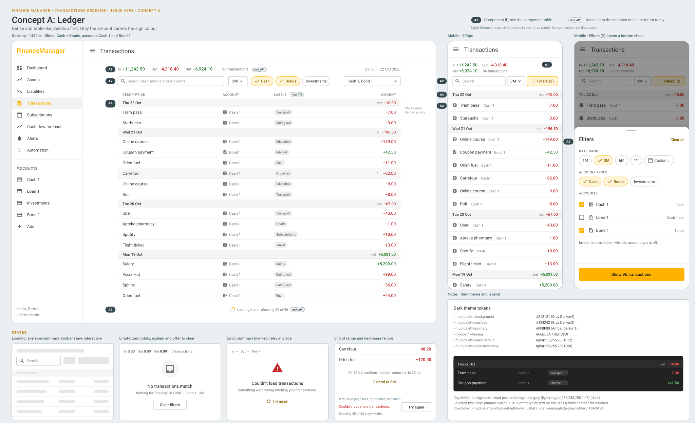
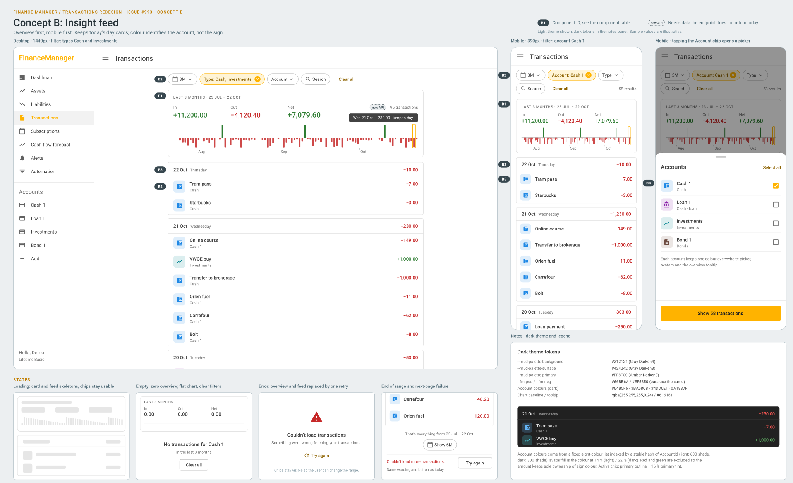
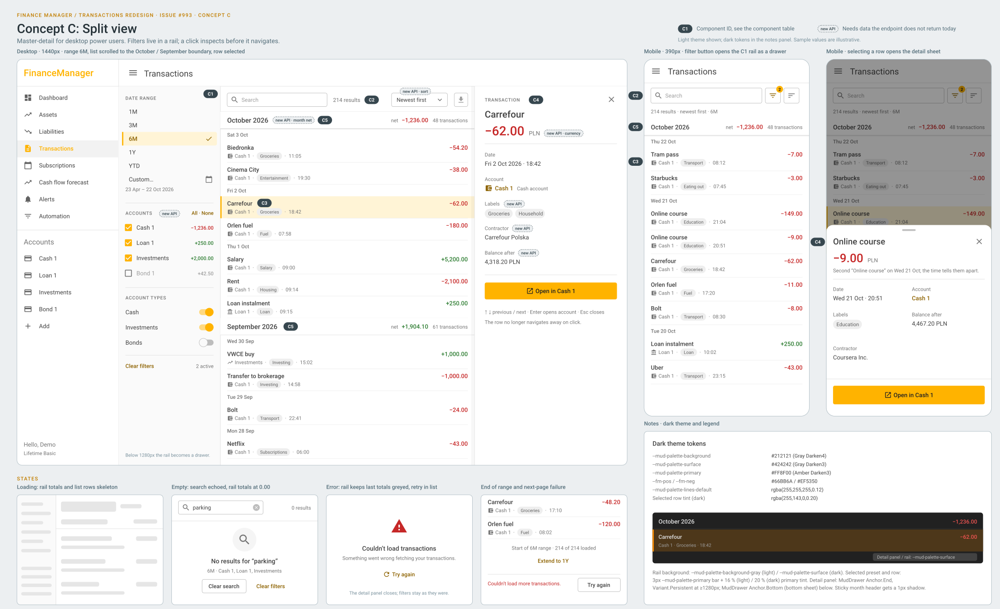

# Transactions page redesign concepts

[Architecture index](../README.md) · [Owning arc42 section](../08-crosscutting-concepts.md)

**Status: design proposal, nothing implemented** ([#993](https://github.com/avresial/FinanceManager/issues/993)). Three concepts for the `/Transactions` page added in #975, each split into components with stable IDs (A1 to C5) so the owner can pick and combine them. A follow-up implementation issue will be filed from the chosen mix.

Baseline: `develop` at `dd933e70` (2026-10-22), guest demo data. The issue asked for `docs/mockups/`. The mockups live in [`concepts/mockups/`](mockups/) instead, next to the existing transaction automation mockup, because the arc42 migration moved them there ([migration inventory](../migration.md)).

## Current page

Sources: [`TransactionsPage.razor`](../../../code/FinanceManager.Components/Features/Dashboard/Components/Pages/TransactionsPage.razor), [`TransactionLogToolbar.razor`](../../../code/FinanceManager.Components/Features/Dashboard/Components/TransactionLogToolbar.razor), [`TransactionLogRow.razor`](../../../code/FinanceManager.Components/Features/Dashboard/Components/TransactionLogRow.razor), [`transaction-log-card.css`](../../../code/FinanceManager.Components/wwwroot/css/transaction-log-card.css).

The audit in #993 found these problems. The tables below refer to them by number:

| # | Problem |
| --- | --- |
| P1 | No overview: no range totals, no day net; the day header spends its right side on the entry count. |
| P2 | Sign-tinted avatar repeats the amount colour, and every cash row has the same wallet icon. |
| P3 | Low desktop density: rows are about 64px, and the name and amount sit about 1400px apart. |
| P4 | The account line repeats on every row and has no visual weight when it matters. |
| P5 | Uneven toolbar (40px select next to 32px controls, search opens a second row); on mobile it scrolls sideways and clips the Accounts filter. |
| P6 | Active filters are hard to see; there is no Clear filters action and no result count. |
| P7 | Thin identity: no time, label or currency; two "Online course" rows on 21 Oct cannot be told apart. |
| P8 | A bare "Load more" button with no sense of how much is loaded. |

### What the endpoint returns today

`GET api/TransactionLog/Page/{userId}` ([controller](../../../code/FinanceManager.Api/Features/Dashboard/Controllers/TransactionLogController.cs)) returns a [`TransactionLogPage`](../../../code/FinanceManager.Domain/Dashboard/Dtos/TransactionLogPage.cs): the items and a next cursor. It returns no total count and no totals. Each [`TransactionLogEntryDto`](../../../code/FinanceManager.Domain/Dashboard/Dtos/TransactionLogEntryDto.cs) has `AccountId, AccountName, AccountType, EntryId, Date, ValueChange, Description`.

Two facts the tables rely on:

- `Date` is the entry's full `PostingDate`, so **time of day is already available**. The account history row already formats it as `HH:mm`.
- Entries carry labels (`FinancialEntryBase.Labels`), and currency accounts carry a `CurrencyId` and an `AccountLabel` (for example `Loan`), but the DTO projects none of them. `AccountType` only distinguishes `Currency`, `Stock` and `Bond`.

"New data needed" values: **none**; **client** (derivable from the rows already loaded); or **new API** (the endpoint must return more). Every new-API item is also marked with a dashed `new API` pill in the mockups.

## Concept A: Ledger

Dense and table-like, desktop first. Only the amount carries the sign colour.

| ID | Component | What changes | New data needed | Fixes |
| --- | --- | --- | --- | --- |
| A1 | Summary strip | One line under the title: *In +X · Out −Y · Net Z · N transactions* for the range and filters, with the resolved range dates on the right. Mobile wraps it to two lines. | **New API**: range summary (in, out, count) for the same query as the page. Loaded pages cannot total a whole range. | P1 |
| A2 | Inline toolbar | Desktop: an always-visible 360px search field on the left, then range, type chips (filled tint and check mark when selected) and the Accounts select, all 32px on one row. Mobile: search, range and a tonal "Filters (2)" button that opens a bottom sheet with range, types, accounts, Clear all and "Show N transactions". | None for the layout. The count on the sheet button uses the A1 summary. | P5, P6 |
| A3 | Single-line rows (36px) | Columns: description, account (type icon and name), label chips, amount. The page uses `MaxWidth.Medium` (960px), so the amount stays within about 930px of the description. Neutral icon; only the amount is coloured. Hover shows a chevron (the row still links to the account). Mobile: a 44px row with type icon, description · account, and amount; labels are hidden. | **New API**: labels on the DTO. | P2, P3, P4, P7 (labels) |
| A4 | Day divider | A thin 28px sticky row, *Thu 22 Oct · net −10.00*, replaces the per-day card and the entry count. | **Client**: the sum of the day's loaded rows. It is exact once the day is fully loaded; for exact values at page boundaries, use daily buckets from the summary (see B1). | P1 |
| A5 | Infinite scroll | A sentinel after the last row loads the next page automatically. The footer reads "Loading more · showing 25 of N". At the end it reads "All N transactions loaded · range starts …" with "Extend to 6M". A failed page shows the current message and Try again. | **New API**: total count (from the A1 summary). The sentinel needs a small `IntersectionObserver` JS interop module, but no new package. | P8 |

## Concept B: Insight feed

Overview first, mobile first. Keeps today's day cards; colour identifies the account, not the sign.

| ID | Component | What changes | New data needed | Fixes |
| --- | --- | --- | --- | --- |
| B1 | Range overview card | In, out, net and count for the range, plus a daily net bar chart (green up, red down; very large days clamp so the chart stays readable). Hover or tap shows a tooltip; selecting a bar scrolls to that day, loading pages until it is reached. Mobile uses a compact three-column version. | **New API**: range summary with daily buckets. | P1 |
| B2 | Filter chips row | One chip each for range, type, account and search. An active filter is filled with the primary tint and has an × to remove it; an inactive one is outlined with ▾. Clear all and a result count follow. On mobile the row **wraps** to a second line instead of scrolling. Type and Account chips open pickers (bottom sheet on mobile). | None for the layout. The result count uses the B1 summary. | P5, P6 |
| B3 | Grouped day cards | Today's cards stay; the header's right side shows the day net in the sign colour instead of "5 entries". | **Client**, with the same caveat as A4. | P1 |
| B4 | Account-coloured avatars | The avatar tint and icon come from the account, not the sign. A stable colour comes from a fixed eight-colour list (red and green excluded) indexed by `AccountId`. Icons: wallet for cash, bank for loan, trending-up for investments, document for bonds. The amount keeps the sign colour. | **Client** for colour and the cash/stock/bond icons. The loan icon needs **new API**: `AccountLabel` on the DTO or the account list. | P2, P4 |
| B5 | Collapsed account line | When the filter narrows to one account, the account caption is hidden and rows shrink to 48px single-line rows. | None | P4, P3 (mobile) |

## Concept C: Split view

Master-detail for desktop power users. Filters live in a rail; a click inspects a transaction before it navigates.

| ID | Component | What changes | New data needed | Fixes |
| --- | --- | --- | --- | --- |
| C1 | Left filter rail | At 1280px and wider, a persistent 240px rail holds range presets with the resolved dates, account checkboxes with each account's net for the range, account-type switches, and Clear filters with the active count. Below 1280px it becomes a drawer opened by a filter icon button with a count badge. | **New API**: per-account totals (summary grouped by account). | P5, P6 |
| C2 | Compact header toolbar | Search, result count, sort (newest, oldest, largest amount) and a disabled export icon button as a placeholder. Mobile: search plus filter and sort icon buttons, with the count on the line below. | **New API**: count; a sort parameter. Today's cursor is keyed on date, account type and entry ID, so amount sort needs a different cursor. | P5, P6 (count) |
| C3 | Two-line rows with metadata | Line 1: description and amount. Line 2: type icon, account · label chip · time. The selected row gets a primary tint and a 3px bar. When the detail panel is closed, the list has a max width of 880px. | Labels: **new API**. Time: **client** (`Date` already includes the posting time). | P2, P3, P4, P7 |
| C4 | Detail panel | Clicking a row selects it and opens a right-side panel (`MudDrawer` `Anchor.End`, persistent) or, on mobile, a bottom sheet. It shows the amount with currency, date and time, an account link, labels, contractor and balance after, plus an "Open in account" button. Keyboard: ↑/↓ move, Enter opens the account, Esc closes. | **New API**: entry details (currency, contractor, balance after, labels), either as a detail endpoint or as extra DTO fields. | P7 |
| C5 | Month headers | A sticky month header with the monthly net and count sits above smaller day subheaders. It is shown when the range spans more than one month (6M, 1Y, long custom ranges). | **New API**: monthly buckets from the summary (loaded rows give only part of a month). | P1, P8 (orientation) |

At 1440px with the navigation drawer open, the desktop width splits into nav 240, rail 240, list 600 and panel 360. Closing either drawer gives the list its 880px.

## State coverage

| State | A: Ledger | B: Insight feed | C: Split view |
| --- | --- | --- | --- |
| Loading | Summary and single-line row skeletons; the toolbar stays usable. | Overview card skeleton with bar placeholders, plus day-card skeletons with avatar squares. | Rail totals, toolbar, month header and two-line row skeletons. |
| Empty | Zero totals, "No transactions match" explaining the filters, Clear filters. | Zero overview with a flat chart, "No transactions for Cash 1", Clear all. | The search is echoed ("No results for “parking”"), rail totals at 0.00, Clear search and Clear filters. |
| Error | The summary shows "—"; "Couldn't load transactions" with Try again in place. | Overview and feed are replaced by one retry; the chips stay so the range can be changed. | Retry in the list; the detail panel closes; filters stay. |
| End of range | "All N transactions loaded · range starts …" and Extend to 6M; a failed next page shows the current message and Try again. | "That's everything from …", a Show 6M chip, and the failed-page message. | "Start of 6M range · N of N loaded", Extend to 1Y, and the failed-page message. |

Mobile toolbar overflow (P5) is fixed in all three: A fits search, range and Filters into 358px and moves the rest into a sheet; B wraps chips onto a second line; C keeps search plus two icon buttons and moves the filters into the drawer.

## Data the endpoint would need

| Addition | Used by | Notes |
| --- | --- | --- |
| Range summary: in, out, net, count; optional daily and monthly buckets; optional per-account totals. Same filters as `Page`. | A1, A2 (count), A5, B1, B2 (count), C1, C2 (count), C5; makes A4/B3 exact | One endpoint serves all three concepts. Mixed currencies must be converted to the user's display currency (as the dashboard services already do) or reported per currency; a plain sum across currencies is wrong. On the client it is a card-like surface, so it should follow the [UI snapshot guide](ui-snapshots.md). |
| Labels on `TransactionLogEntryDto` | A3, C3, C4 | Entries already carry labels; this is a projection change in the service and repositories. |
| `AccountLabel` on the DTO or account list | B4 (loan icon) | Otherwise loans show the cash icon. |
| Currency code | C4 (and any per-row currency display) | From `CurrencyAccount.CurrencyId`; bonds and investments need their own source. |
| Entry details: contractor, balance after | C4 | `CurrencyAccountEntry.ContractorDetails` and `Value`; could be a per-entry detail endpoint. |
| Sort parameter | C2 | Amount sort needs a new cursor shape. |

## Mixing guide

- **Filter surface: pick one** of A2, B2, or C1 with C2. They are alternatives. B2's filled active chip with × and Clear all can style A2's sheet or C1's rail.
- **Overview: A1 or B1.** Both use the same summary endpoint, so A1 can ship first and grow into B1. C5 works with either.
- **Rows: A3, B3 with B4 (and B5), or C3.** A4 dividers pair with A3 or C3; B3 cards pair with B4. B4's avatar can replace C3's type icon.
- **Pagination:** A5 works with every row style.
- **C4** works with any row style but changes what a click does. The dashboard card shares `TransactionLogRow`, so that behaviour must stay page-only.

## Recommended mix

Recommended: **A2 + A4 + C3 + A5, then A1, with B4 and B5 as cheap add-ons.**

- It needs the least backend work. The first pass ships with **no API change**: toolbar and sheet, day net, two-line rows with time, infinite scroll without "of N", and account avatars. That pass fixes P2 to P6, the time part of P7, and most of P8.
- One summary endpoint then unlocks A1 and the counts. Labels on the DTO complete P7.
- One row component (C3) works at both breakpoints. A3 needs a separate mobile row that hides labels, so it is two layouts to keep in sync.
- Click behaviour is unchanged, and so are the shared dashboard row and the existing day grouping.

Alternatives, and when each is the better choice:

- **B-led** (B1 + B2 + B3 + B4 + B5): if mobile is the main way the page is used, or the owner wants the chart. It costs the same summary endpoint plus daily buckets, and the jump-to-day flow is the most complex client behaviour of all the components.
- **C-led** (C1 + C2 + C3 + C4 + C5): if the page becomes a reconciliation tool (checking entries, then editing them in place). It needs the most data (per-account totals, sort, entry details), changes click behaviour, and leaves the list only 600px wide at 1440px while both drawers are open.
